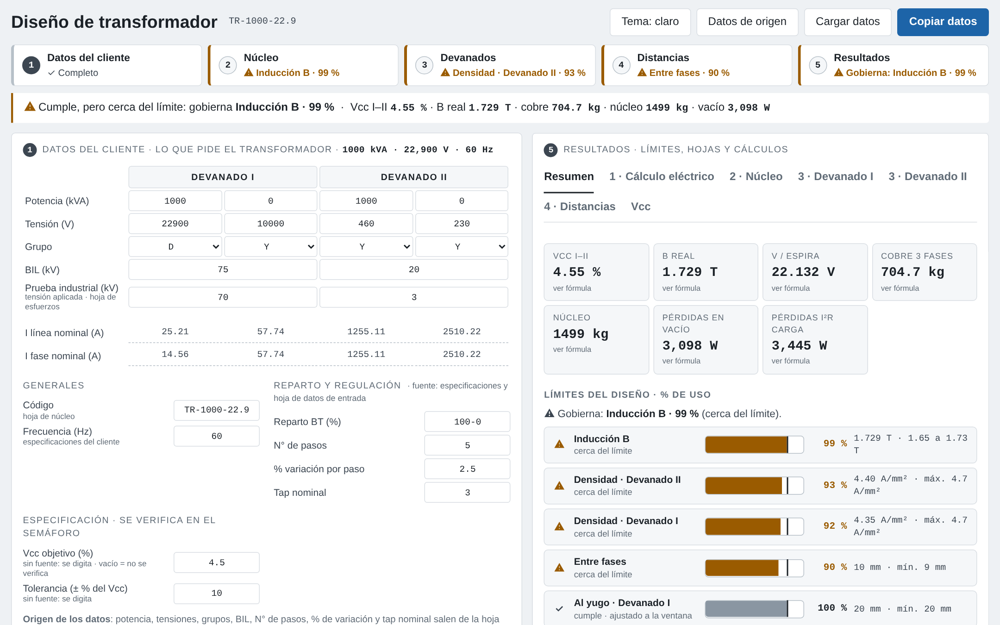
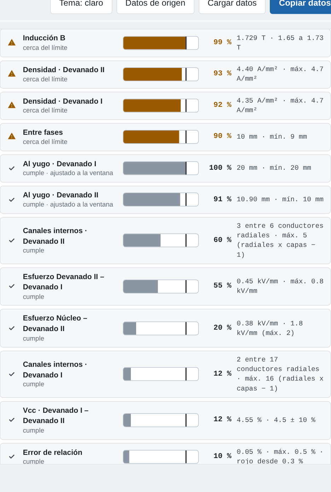
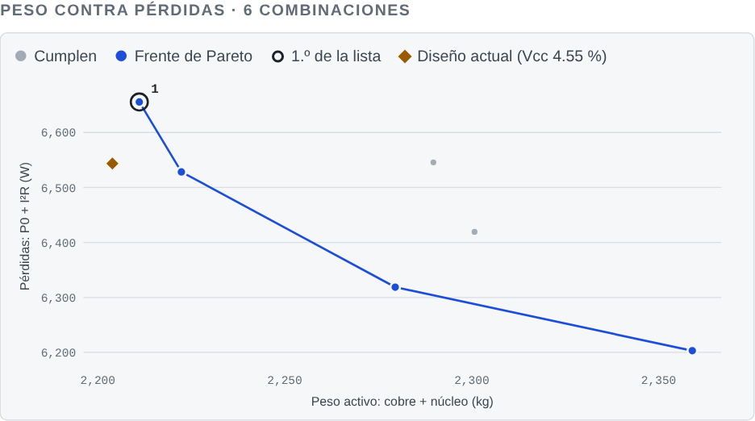
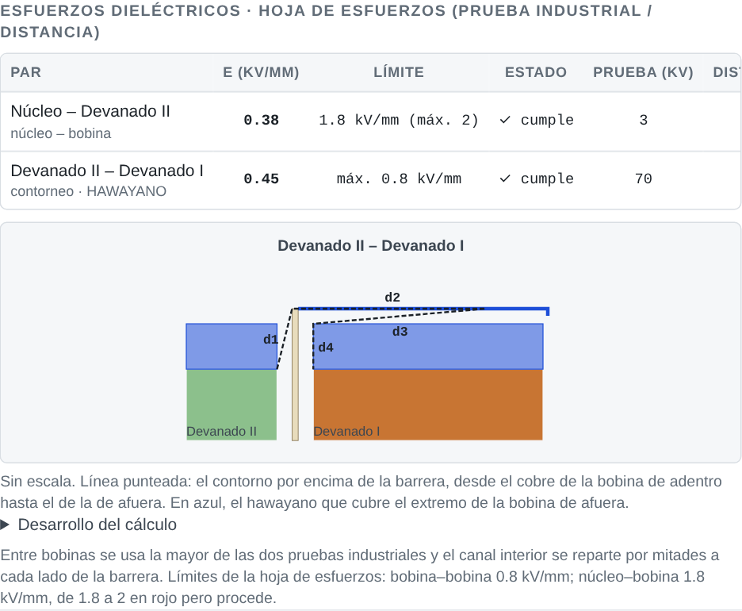
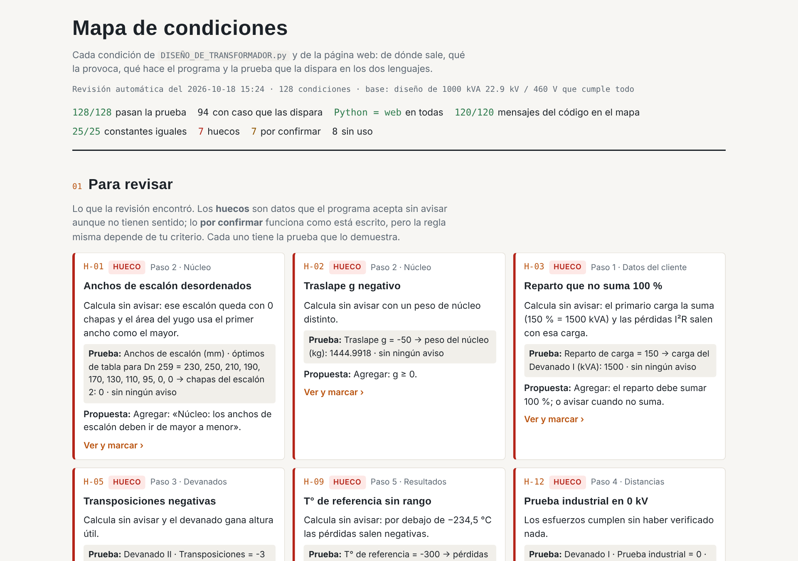

# Diseño de transformadores de distribución

[](https://github.com/jhonmiltonpedz/diseno-transformador/actions/workflows/verificacion.yml)
[](https://jhonmiltonpedz.github.io/diseno-transformador/)

Herramienta de ingeniería para diseñar transformadores trifásicos de distribución, desde los datos del cliente hasta la tensión de cortocircuito (Vcc), las pérdidas y los esfuerzos dieléctricos. Reemplaza un conjunto de hojas de cálculo sueltas por un solo flujo guiado: **el núcleo fija el espacio, los devanados se construyen dentro de la ventana y el programa dice qué límite gobierna y cuántos milímetros faltan cuando algo no entra.**

La misma lógica está escrita dos veces, en **Python** (Jupyter con ipywidgets) y en **JavaScript** (una página web sin dependencias), y una **verificación automática** comprueba en cada cambio que las dos den exactamente los mismos resultados.

**[→ Abrir la demo](https://jhonmiltonpedz.github.io/diseno-transformador/)** · [Mapa de condiciones del programa](https://jhonmiltonpedz.github.io/diseno-transformador/mapa-condiciones.html)

> Nació en el área de diseño de una fábrica de transformadores de distribución. Los datos de ejemplo son de un diseño de referencia genérico de 1000 kVA, 22.9 kV / 460-230 V.

### In English

A design tool for three-phase distribution transformers: customer data → stepped core → windings fitted inside the core window → electrical clearances → short-circuit impedance (Vcc), no-load and load losses, and dielectric stresses. It also searches all buildable conductor arrangements for a target Vcc and plots the weight-vs-losses Pareto front. The same engineering logic is implemented in Python (Jupyter/ipywidgets) and in dependency-free JavaScript, and a CI check runs 128 documented design rules in both and requires identical results. The interface is in Spanish.



## Qué hace

El diseño sigue el orden real del taller, y la pantalla también:

| Paso | Qué se ingresa | Qué calcula |
|---|---|---|
| **1 · Datos del cliente** | Potencia, tensiones (una o dos por devanado), grupos, BIL, prueba industrial, frecuencia, reparto de carga, taps | Corrientes de línea y de fase |
| **2 · Núcleo** | Dn, De, Hc y anchos de escalón | Chapas por escalón, sección neta, espiras de referencia (E = 4.44·f·N·B·A), inducción real, peso y pérdidas en vacío |
| **3 · Devanados** | Conductor, arreglo y tipo (continuo, galleta, francés, hélice simple o doble) | Espiras y error de relación de cada tensión y toma, capas, radial, axial, densidad de corriente |
| **4 · Distancias** | Mínimos de aislamiento mayor, barreras, rellenos | Distancia real al yugo y entre fases, esfuerzos dieléctricos núcleo–bobina y bobina–bobina |
| **5 · Resultados** | — | Vcc, cobre, pérdidas I²R, semáforo de límites con % de uso y el límite que gobierna |

Con **«Ajustar a la ventana»** las espiras por capa salen de la altura que deja el núcleo (Hc − 2 × distancia mínima al yugo) y de ahí el número de capas, el radial y los diámetros. Si un devanado no entra, el programa no lo esconde: calcula igual y marca en rojo cuántos milímetros faltan.

La **búsqueda por Vcc** prueba todas las combinaciones fabricables de conductores de stock (calibre y arreglo, en los tipos de devanado elegidos) para cada diámetro de núcleo de un rango, deja las que cumplen el Vcc objetivo, la densidad de corriente y la inducción y entran en el núcleo, y las muestra en un frente de Pareto de peso activo contra pérdidas. Las mejores se recalculan con el diseño completo para confirmar el resultado, y cualquiera se carga al diseño con un botón.

<p align="center">
  
  
</p>

## Cálculos principales

- **Núcleo escalonado:** chapas de 0.27 mm por escalón (redondeadas a decenas), sección neta con el factor de apilamiento, peso con 7650 kg/m³; anchos óptimos de tabla según el número de escalones.
- **Espiras:** las de referencia salen de la menor tensión de fase, `N = REDONDEO.MAS(V / (4.44·f·B·Sn))`, así la inducción real nunca pasa la objetivo. Las demás tensiones y cada toma del regulador se redondean y se verifica su **error de relación** (hasta 0.3 % cumple, de 0.3 a 0.5 % procede en rojo, más de 0.5 % no procede).
- **Devanados:** reglas de fabricación por tipo (conductores máximos, horizontales, radiales, capas fijas del francés y la hélice), canales de refrigeración dentro de la espira, transposiciones, galleta en dos bobinas axiales.
- **Vcc:** reactiva `= (N·I)·(π·Dm)·(λ + (e₁ + e₂)/3)·kR·K / (Heq·B·Sfe)` con el factor de Rogowski kR según la corriente; activa `= Pcu / (S·10)`; `Vcc = √(reactiva² + activa²)`.
- **Pérdidas:** en vacío con una regresión cuadrática por mínimos cuadrados de la curva W/kg de la chapa (leída a B real + 0.099 T, con interpolación entre 50 y 60 Hz); en carga, `3·I²·R` con la resistencia del cobre a la temperatura de referencia.
- **Esfuerzos dieléctricos:** núcleo–bobina `E = prueba industrial / (canal + tubo)`; bobina–bobina por contorneo sobre la barrera (hawayano o tubo), con su dibujo.



## Verificación: el mapa de condiciones

Con la lógica escrita en dos lenguajes, el riesgo es que se separen sin que nadie lo note. Por eso cada condición del programa (cada dato que falta, cada validación, cada límite del semáforo, cada fórmula que elige un camino) está anotada en [`verificacion/reglas.py`](verificacion/reglas.py) con su origen, la causa que la dispara, qué hace el programa y qué hacer, junto con **un caso de prueba que la dispara** sobre un diseño base que cumple todo.

[`verificacion/comparar_mapa.py`](verificacion/comparar_mapa.py) corre en cada cambio (GitHub Actions) y falla si alguna de estas cinco cosas no se cumple:

1. Cada caso dispara su condición y el diseño base no, **igual en Python y en la web**.
2. Cada condición está en el código de los dos lenguajes, en la función que dice el mapa.
3. Cada mensaje de error o aviso y cada límite del semáforo que hay en el código tiene su condición en el mapa (una condición nueva sale como «sin regla» hasta que se documenta).
4. Las constantes y tablas (Rogowski, curva de pérdidas, reglas de cada tipo de devanado, conductores de stock…) son idénticas en los dos lenguajes.
5. Los datos iniciales coinciden en los dos lenguajes y los que no tienen fuente arrancan vacíos.

Resultado actual: **128 condiciones, 94 con caso propio, todas pasan; 120 de 120 mensajes y límites del código documentados; 25 constantes idénticas.** La revisión también deja a la vista lo que falta: 7 «huecos» (datos que hoy se aceptan sin aviso, como un traslape negativo o un reparto de carga que no suma 100 %) y 7 reglas por confirmar. Están en el [mapa de condiciones](https://jhonmiltonpedz.github.io/diseno-transformador/mapa-condiciones.html), cada uno con la prueba que lo demuestra.



## Decisiones de diseño

- **El núcleo manda.** Las bobinas se construyen dentro de la ventana; las distancias se verifican con lo que queda. Así el diseño no puede «pasar» con un devanado que no cabe.
- **Cada dato con su origen.** Lo que no tiene fuente arranca vacío y se digita; el programa no inventa valores y lista lo que falta.
- **Mostrar el porqué.** Cada resultado abre su fórmula con los valores puestos y de dónde sale; el semáforo dice el % de uso de cada límite y cuál gobierna.
- **Color solo para lo que hay que atender** (como en las pantallas industriales ISA-101): gris lo normal, ámbar si falta un dato o está cerca, rojo si no cumple, siempre con ícono y texto.

## Estructura

```
python/DISENO_DE_TRANSFORMADOR.py   programa en Jupyter (ipywidgets): pantalla de ingreso y hojas de cálculo
web/                                fuentes de la página: calc.js (cálculo), optimiza.js (búsqueda por Vcc),
                                    ui.js y ui_busqueda.js (interfaz), plantilla.html, armar.py
docs/index.html                     la página armada, un solo archivo sin dependencias (la demo)
docs/mapa-condiciones.html          el mapa de condiciones con la última revisión
verificacion/                       reglas.py (catálogo), disparar.py / disparar.js (corren cada caso en cada lenguaje),
                                    comparar_mapa.py (la revisión), armar_mapa.py
```

## Uso

**En el navegador:** abre la [demo](https://jhonmiltonpedz.github.io/diseno-transformador/) o `docs/index.html` directamente; no necesita servidor ni instalación. Los datos se guardan en el navegador y se pueden copiar y cargar como JSON. La demo abre con el diseño de referencia, que con De = 510 mm no entra por 14 mm entre fases: el programa lo marca. Con De = 525 mm cumple (es la captura de arriba).

**En Jupyter:**

```bash
pip install -r requirements.txt
jupyter lab            # y en una celda:  %run python/DISENO_DE_TRANSFORMADOR.py
```

**Verificación y armado de las páginas** (Python 3.11+ y Node 18+):

```bash
python3 verificacion/comparar_mapa.py   # revisa las 128 condiciones en Python y en la web
python3 verificacion/armar_mapa.py      # vuelve a armar docs/mapa-condiciones.html
python3 web/armar.py                    # vuelve a armar docs/index.html desde web/
```

## Supuestos y límites

- Es una herramienta de anteproyecto: no reemplaza la revisión del diseñador ni los ensayos.
- Los datos de ejemplo son genéricos. Tres valores del diseño de referencia están marcados como supuestos por validar: temperatura de referencia 75 °C (IEC 60076-1), entre fases mínimo 9 mm y 3 transposiciones en la baja tensión.
- La constante K de la Vcc es 0.018 (la de las hojas originales); el valor teórico es 0.01777 y la diferencia es de 1.3 % en la Vcc reactiva.
- Las pérdidas en carga son en corriente continua, sin pérdidas adicionales.

## Tecnologías

Python 3 · ipywidgets · JavaScript, HTML, CSS y SVG sin librerías · Node.js (verificación) · GitHub Actions · GitHub Pages

## Autor

**Jhon Peralta** · diseño de transformadores de distribución · [github.com/jhonmiltonpedz](https://github.com/jhonmiltonpedz)
